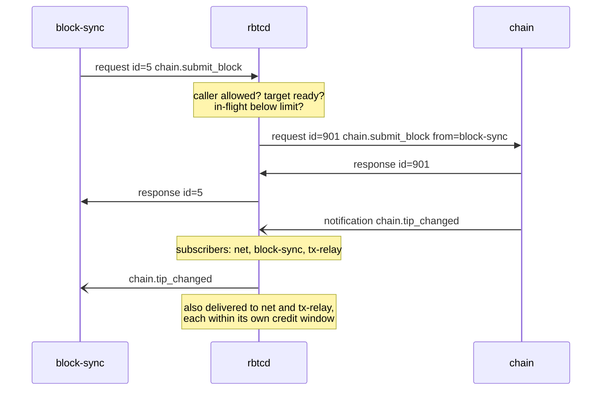

# Bus protocol

How `rbtcd` and the subdaemons exchange messages. Applies to every subdaemon.

## Transport

- `rbtcd` creates one Unix stream socketpair per subdaemon and passes one end to the child as **file descriptor 3**. The child MUST NOT use stdin or stdout for the protocol. stdin is `/dev/null`, stdout is discarded.
- The child's **stderr is its log**. `rbtcd` reads each line and writes it to the node log prefixed with the daemon name. Log lines are free text in v0.1.
- When the bus connection reaches end-of-file, the child MUST exit at once, without waiting for in-progress work.
- The **operator socket** is a Unix stream socket at `<datadir>/<network>/rbtc.sock`, created with mode `0600`. It speaks the same framing and envelope, restricted to requests ([rpc.md](rpc.md#operator-socket)).

## Framing

- One message is one JSON object, serialized without newlines and terminated by `\n` (JSON lines).
- Encoding is UTF-8.
- A frame MUST NOT exceed `max_frame` bytes, default 64 MiB. That fits the largest block in hex with a wide margin.
- A subdaemon that sends a frame that is not valid JSON, exceeds `max_frame`, or violates the rules in this file has broken the protocol. `rbtcd` logs the violation and stops the node ([lifecycle.md](lifecycle.md#failures)). On the operator socket the same violations only close that client's connection.

## Envelope

The shapes are JSON-RPC 2.0. `params` is always an object (named parameters only).

| Shape | Members | Used for |
|---|---|---|
| Request | `jsonrpc`, `id`, `method`, `params`, `from`¹ | RPC calls, hook calls, `bus.init`, `bus.shutdown` |
| Notification | `jsonrpc`, `method`, `params`, `from`¹ | events, one-way RPCs, bus control messages |
| Response | `jsonrpc`, `id`, `result` or `error` | answers to requests |

¹ `from` is set by `rbtcd` on requests and one-way RPCs it delivers to a subdaemon: the caller's daemon name, `operator`, or `node` when the caller is `rbtcd` itself. Subdaemons MUST NOT set it; `rbtcd` ignores any value a subdaemon sends.

```json
{"jsonrpc":"2.0","id":17,"method":"chain.submit_block","params":{"block":"0100…","peer":42}}
{"jsonrpc":"2.0","id":17,"result":{"status":"connected","tip":{"hash":"0000…","height":850001}}}
{"jsonrpc":"2.0","method":"chain.block_connected","params":{"hash":"0000…","height":850001,"prev":"0000…"}}
```

`error` objects are `{"code": <integer>, "message": <string>, "data": <any, optional>}`. Codes are listed in [rpc.md](rpc.md#error-codes).

### Request ids

- An `id` is an unsigned integer chosen by the sender, unique among that sender's outstanding requests on its connection.
- `rbtcd` assigns its own id when it forwards a request, and maps the response back to the original id. Ids never leak between connections.

## Message classification

`rbtcd` classifies every message by its shape and its method name. Names are unique across kinds, which [manifest.md](manifest.md#validation) checks at startup.

Messages a subdaemon `S` sends:

| Shape | Method | Meaning | Routing |
|---|---|---|---|
| Notification | `S.<event>`, declared in S's `emits.events` | event | to every subscriber of the event |
| Notification | `T.<rpc>`, a one-way RPC of another daemon T | one-way RPC | to T |
| Request | `T.<rpc>` or `node.<rpc>` | RPC | to T (or handled by `rbtcd`), response back to S |
| Request | `hook.<name>`, declared in S's `emits.hooks` | hook | to each hook subscriber in turn, aggregated result back to S |
| Request | `bus.init` | manifest | handled by `rbtcd` |
| Notification | `bus.ready`, `bus.ack` | control | handled by `rbtcd` |
| Response | — | answer to a request `rbtcd` delivered | back to whoever sent the original request |

Messages `rbtcd` sends to a subdaemon `S`:

| Shape | Method | Meaning |
|---|---|---|
| Notification | `X.<event>` where X ≠ S | an event S subscribed to |
| Notification | `S.<rpc>` | a one-way RPC call to S |
| Request | `S.<rpc>` | an RPC call to S |
| Request | `hook.<name>` | a hook call S subscribed to |
| Notification | `bus.start`, `bus.pause`, `bus.resume` | control |
| Request | `bus.shutdown` | control |
| Response | — | answer to S's `bus.init`, RPC or hook |

Anything else is a protocol violation: emitting an event not declared in the manifest, calling an RPC not listed in `calls`, emitting a hook not declared in `emits.hooks`, answering a request that was never sent.

## Physical path of a message

Flow diagrams elsewhere draw `block-sync → chain: chain.submit_block`. This is what physically happens:



## Ordering guarantees

1. **Notifications from one source to one destination arrive in the order they were sent.** This covers events and one-way RPCs. For example, `net.peer_connected` for peer 7 always reaches `block-sync` before `net.headers` from peer 7, and `net.peer_disconnected` comes after every other event about peer 7.
2. There is **no ordering between different sources**. An event from `chain` and an event from `net` may arrive in either order.
3. There is **no ordering between notifications and responses**, even from the same source. Responses are never held behind notifications waiting for credit. Example: `block-sync` may receive the response to `chain.submit_block` before or after the `chain.tip_changed` that the same call caused. Handlers must not depend on either order.
4. A hook's emitter receives the result only after every subscriber it reached has answered.
5. Concurrent requests have no order. A caller that needs ordered effects waits for each response before sending the next request.

## Flow control

Three mechanisms bound memory on the bus.

### 1. Readers never block

Every process reads its bus connection continuously and hands messages to handlers through local queues. Slow handlers never stop the reader, so responses and hook results always get through. The credit window below keeps the local queues bounded.

### 2. Credit window for notifications

- For each subdaemon, `rbtcd` tracks the bytes of notifications (events and one-way RPCs) it has delivered but that have not yet been acknowledged.
- `rbtcd` delivers a notification only while that number is below `event_window` (default 32 MiB). A notification larger than the whole window is delivered when nothing else is outstanding.
- After handling notifications, the subdaemon sends `bus.ack {"count": n}`, meaning "the next n notifications are done". `rbtcd` subtracts their sizes. Subdaemons SHOULD acknowledge in batches, for example every 64 notifications or whenever their local queue becomes empty.
- Notifications that do not fit the window wait in `rbtcd`'s per-subdaemon queue, in order.

### 3. Pausing sources

- A subdaemon that takes input from outside the bus declares `"source": true` in its manifest. In v0.1 only `net` does.
- When any subdaemon's waiting queue in `rbtcd` passes `queue_high_water` (default 64 MiB), `rbtcd` sends `bus.pause` to every source. When every queue is back below half of `queue_high_water`, it sends `bus.resume`.
- A paused source stops taking new external input. `net` stops reading from peer sockets, which pushes back on peers through TCP. A paused source still handles requests and notifications and may still emit events. Emitting an event never blocks.
- Worst case, the queues grow past the high-water mark by what sources had already read when they paused: at most one message per peer connection.

### RPC in-flight limit

- `rbtcd` allows at most `rpc_in_flight` (default 64) outstanding requests from one caller to one target. Beyond that it answers at once with error `busy`, without forwarding.
- The operator socket counts as one caller.
- Hook calls do not count against the limit: a hook has one outstanding call per emitter request.

## Bus control messages

| Message | Shape | Direction | Params | Purpose |
|---|---|---|---|---|
| `bus.init` | request | sub → main | the manifest ([manifest.md](manifest.md)) | Register. The response is the go-ahead to initialise. |
| `bus.ready` | notification | sub → main | `{}` | Initialisation done; RPCs may now be routed to this daemon. |
| `bus.start` | notification | main → sub | `{}` | Every daemon is ready; events may flow and sources may start taking input. |
| `bus.ack` | notification | sub → main | `{"count": u32}` | Return credit for handled notifications. |
| `bus.pause` | notification | main → source | `{}` | Stop taking external input. |
| `bus.resume` | notification | main → source | `{}` | Resume taking external input. |
| `bus.shutdown` | request | main → sub | `{}` | Finish or abandon current work, flush, answer, exit. |

Sequences are in [lifecycle.md](lifecycle.md).

## Timeouts

- Hook calls have a per-hook timeout ([events-and-hooks.md](events-and-hooks.md#hook-table)).
- `bus.init`, `bus.ready` and `bus.shutdown` have timeouts set in `[node]` ([lifecycle.md](lifecycle.md#configuration)).
- Bus RPCs have **no timeout** in `rbtcd`. Some legitimately take long (connecting a large block with script checks). A caller MAY stop waiting on its side. A late response is then discarded by the caller. The CLI has its own client-side timeout.

## Limits summary

| Setting (`[node.bus]`) | Default | Meaning |
|---|---|---|
| `max_frame_mib` | 64 | Largest accepted frame |
| `event_window_mib` | 32 | Credit window per subdaemon |
| `queue_high_water_mib` | 64 | Waiting queue size that pauses sources |
| `rpc_in_flight` | 64 | Outstanding requests per caller and target |
