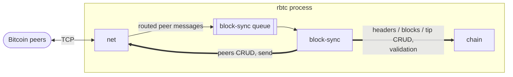

# Architecture overview

## Process and modules

v0.1 runs as one process containing three modules: `net`, `chain`, `block-sync`.



| Interaction                                                | Kind            | Direction              |
|------------------------------------------------------------|-----------------|------------------------|
| Peer messages owned by `block-sync`                        | in-memory queue | `net` → `block-sync`   |
| Peers CRUD, sending a message to a peer                    | direct call     | `block-sync` → `net`   |
| Header and block validation, CRUD for tip, headers, blocks | direct call     | `block-sync` → `chain` |

`chain` calls no other module. `net` calls no other module; it only pushes routed messages into queues.

Queues are bounded. Messages are never dropped from a queue: a full queue is a node failure, and the node stops.

## Module boundaries

Modules are kept separable so that each interaction can later be carried by a message bus instead of a call or a queue:

- A module accesses another module only through that module's
  interface ([net](../modules/net/README.md#interface), [chain](../modules/chain/README.md#interface))
  or by pushing to its queue.
- No module holds references into another module's state or storage. Every call argument, return value and queue item is
  owned data.
- Each module owns its stores exclusively ([storage.md](storage.md)).

## Modes

The node is in one of three modes, owned by `block-sync`:

| Mode     | Flow                                          | Other processes                              |
|----------|-----------------------------------------------|----------------------------------------------|
| IBD      | [mode-ibd.md](../flows/mode-ibd.md)           | Paused, except maintaining peer connections. |
| Standard | [mode-standard.md](../flows/mode-standard.md) | —                                            |
| Reorg    | [mode-reorg.md](../flows/mode-reorg.md)       | Paused, except maintaining peer connections. |

## Lifecycle

TBD

## Configuration

One TOML file. Top-level keys apply to every module; each module reads its own
table ([net](../modules/net/README.md#configuration), [chain](../modules/chain/README.md#configuration), [block-sync](../modules/block-sync/README.md#configuration)).

```toml
network = "main"           # main | testnet4 | signet | regtest
datadir = "~/.rbtc"        # stores live under <datadir>/<network>/
```

## Dependencies

Bitcoin data structures and consensus encoding come from rust-bitcoin. P2P message types and framing come from
`bitcoin-p2p-messages`. Script verification: C-bindings from bitcoin-core.
