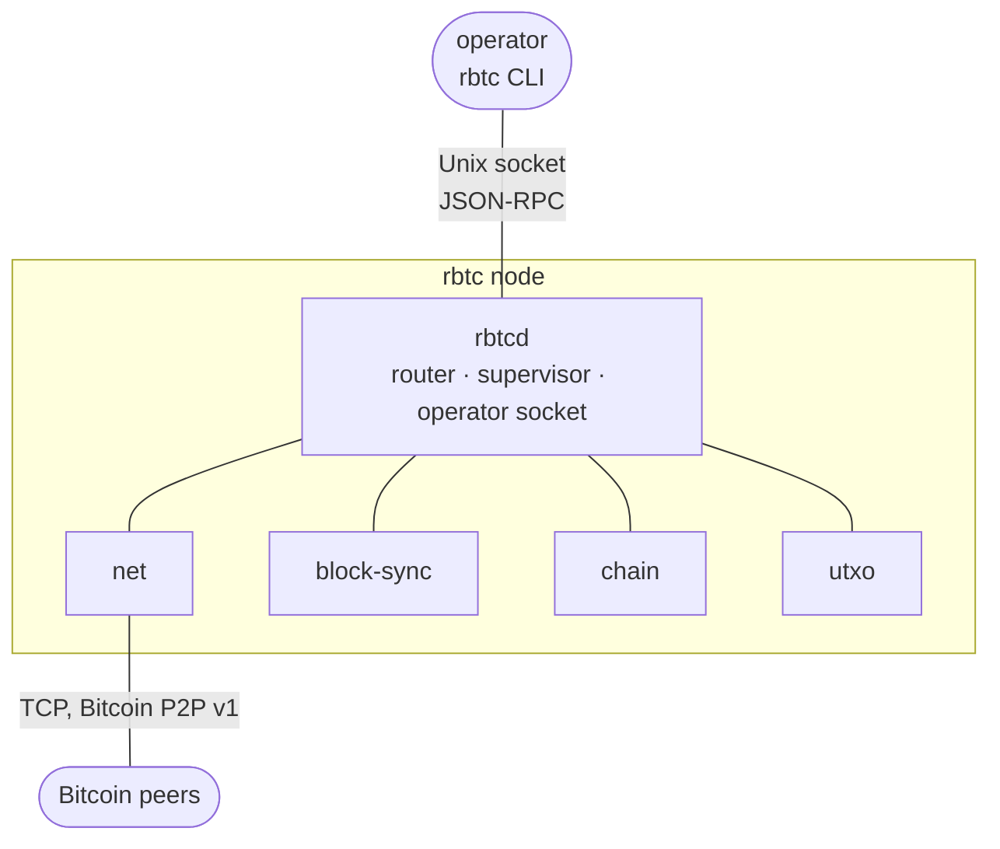
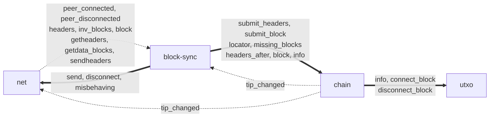
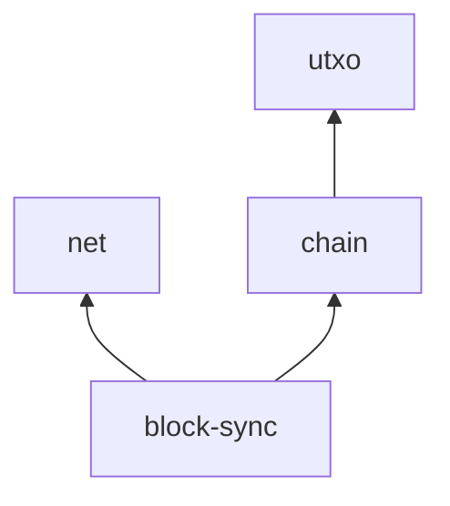

# Architecture overview

## Processes

Physically the bus is a star: each subdaemon has exactly one connection, to `rbtcd`. Subdaemons never connect to each
other directly. Only `net` talks to the internet. Only `rbtcd` listens on the operator socket.

| Process | Binary | Role | Persistent state |
|---|---|---|---|
| main | `rbtcd` | Spawns and supervises subdaemons, validates manifests, routes events, hooks and RPCs, enforces permissions and flow control, serves the operator socket. No Bitcoin logic. | none |
| net | `rbtc-net` | Peer connections, the v1 wire protocol, handshake, keep-alive, address management, peer discipline. Turns wire messages into events and executes `net.send`. | known peer addresses |
| chain | `rbtc-chain` | Headers, the block index, block bodies, header and block checks that need no coins, best-chain selection, reorgs, IBD state. Queries about the chain, blocks and confirmed transactions. | block index, headers, block bodies |
| utxo | `rbtc-utxo` | The UTXO set, undo data, checks that need coins (including scripts), atomic connect and disconnect. Owner of the active tip. | coins, undo data, active chain by height |
| block-sync | `rbtc-block-sync` | Headers sync, block download scheduling, stalling and timeouts, block announcements, serving headers and blocks to peers. | none |

The `rbtc` CLI is not a daemon. It connects to the operator socket, sends one request and prints the response.

## Logical communication

The graph below shows who talks to whom, ignoring that every arrow physically passes through `rbtcd`.

Dotted arrows are events (emitter → subscriber). Thick arrows are RPC calls (caller → callee).

One hook exists (`hook.peer_connected` from `net`). No v0.1 daemon subscribes to it, so it does not appear in the graph.

## Call graph and startup order

RPC calls and hooks are the only synchronous dependencies between daemons. They MUST form a directed acyclic graph
([manifest.md](manifest.md#validation)). The v0.1 graph:

An arrow means "calls RPCs of". Main initialises daemons in a topological order of this graph, dependencies first:
`utxo`, `net`, `chain`, `block-sync`. It shuts them down in reverse ([lifecycle.md](lifecycle.md)).

A daemon MUST NOT call RPCs of any daemon upstream of it. Events are not part of the graph.

## Data ownership

| Data | Owner | Readers (via RPC) |
|---|---|---|
| Headers and block index (status, height, work, validity) | chain | block-sync, operator |
| Block bodies | chain | block-sync (serving peers), operator |
| Best header, IBD flag | chain | block-sync, net (through `chain.tip_changed`) |
| UTXO set, undo data | utxo | chain, operator |
| Active tip and active chain by height | utxo (truth); chain keeps an in-memory copy | everyone through `chain` |
| Peers, addresses, discouraged addresses | net | operator |
| Per-peer sync state, blocks in flight | block-sync | operator |
| Registry (manifests, subscriptions, permissions) | rbtcd | operator |

Each daemon stores its persistent data in its own stores under `<datadir>/<network>/<daemon>/`
([storage.md](storage.md)).

## Validation split

Where each part of Bitcoin Core's validation runs:

| Core function | Runs in | Needs |
|---|---|---|
| `CheckBlockHeader` (proof of work) | chain | header |
| `ContextualCheckBlockHeader` (difficulty, timestamps, version) | chain | header ancestors |
| `CheckBlock` (merkle root, size, coinbase, `CheckTransaction`, legacy sigops) | chain | block |
| `ContextualCheckBlock` (finality, BIP34 height, witness commitment, weight) | chain | block, ancestors |
| `GetBlockScriptFlags`, assumevalid decision | chain | block index, deployments |
| `ConnectBlock`: BIP30, `Consensus::CheckTxInputs`, BIP68 `SequenceLocks`, sigop cost, scripts, coinbase value | utxo | coins, flags from chain |
| `DisconnectBlock` | utxo | undo data, block from chain |
| `ActivateBestChain`, `FindMostWorkChain`, invalidity marking | chain | block index |
| `IsInitialBlockDownload` | chain | tip, minimum chain work |

Script verification in v0.1 uses libbitcoinkernel through the `bitcoinkernel` crate, called from `utxo`.

## Dependencies

Bitcoin data structures and consensus encoding come from rust-bitcoin; P2P message types and v1 framing come from
`bitcoin-p2p-messages`.
