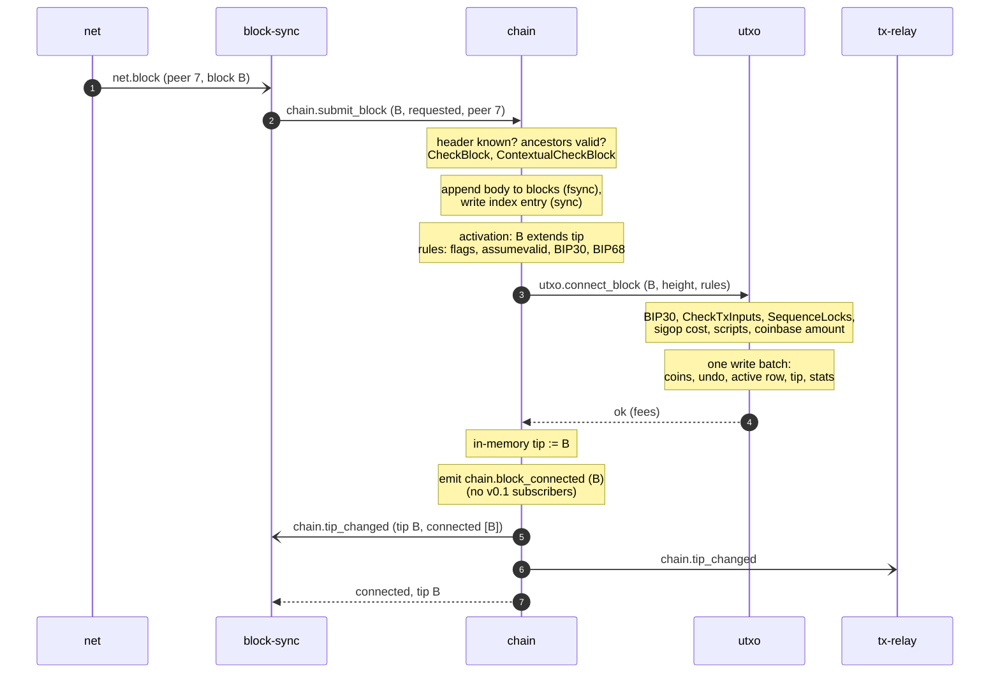
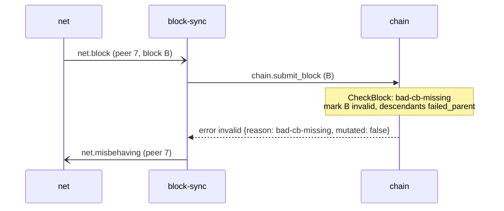

# Block processing

One block from the moment `net` decodes it to the moment the UTXO set reflects it. Rules: [chain block submission](../daemons/chain/README.md#block-submission), [utxo](../daemons/utxo/README.md), [storage write ordering](../architecture/storage.md#write-ordering).

## Valid block extending the tip



Order guarantees used here:

- The block is durable in `chain` before step 3 asks `utxo` to commit it.
- Events (steps 5–6) are emitted only after `utxo` has answered (step 4).
- The events and the response (step 7) may reach `block-sync` in any order ([bus-protocol.md](../architecture/bus-protocol.md#ordering-guarantees)).

## Block that fails `chain`'s checks



If the failure means the block was **mutated** (for example `bad-txnmrklroot`), `chain` does not mark the header invalid, and replies `mutated: true`. `block-sync` still punishes the peer; the block stays missing and the scheduler fetches it from another peer.

## Block that fails `utxo`'s checks

```mermaid
sequenceDiagram
    participant N as net
    participant BS as block-sync
    participant C as chain
    participant U as utxo
    BS->>C: chain.submit_block (B)
    Note over C: checks pass, store B
    C->>U: utxo.connect_block (B)
    Note over U: input missing:<br/>nothing written
    U-->>C: error invalid {reason: bad-txns-inputs-missingorspent}
    Note over C: mark B invalid,<br/>descendants failed_parent;<br/>tip unchanged
    C-->>BS: error invalid {reason: bad-txns-inputs-missingorspent}
    BS-)N: net.misbehaving (peer)
```

A failed `utxo.connect_block` writes nothing; the UTXO set and the tip are unchanged.

## Block on a side branch

A valid block whose branch has less work than the active chain is checked and stored, and `chain.submit_block` returns `stored`. If later blocks give that branch more work, activation switches to it ([reorg.md](reorg.md)).

## Unrequested block

A block that `block-sync` did not request (`requested: false`) is processed only if it would give the chain more work than the tip and is at most 288 blocks ahead; otherwise `chain` returns `ignored` and stores nothing.
