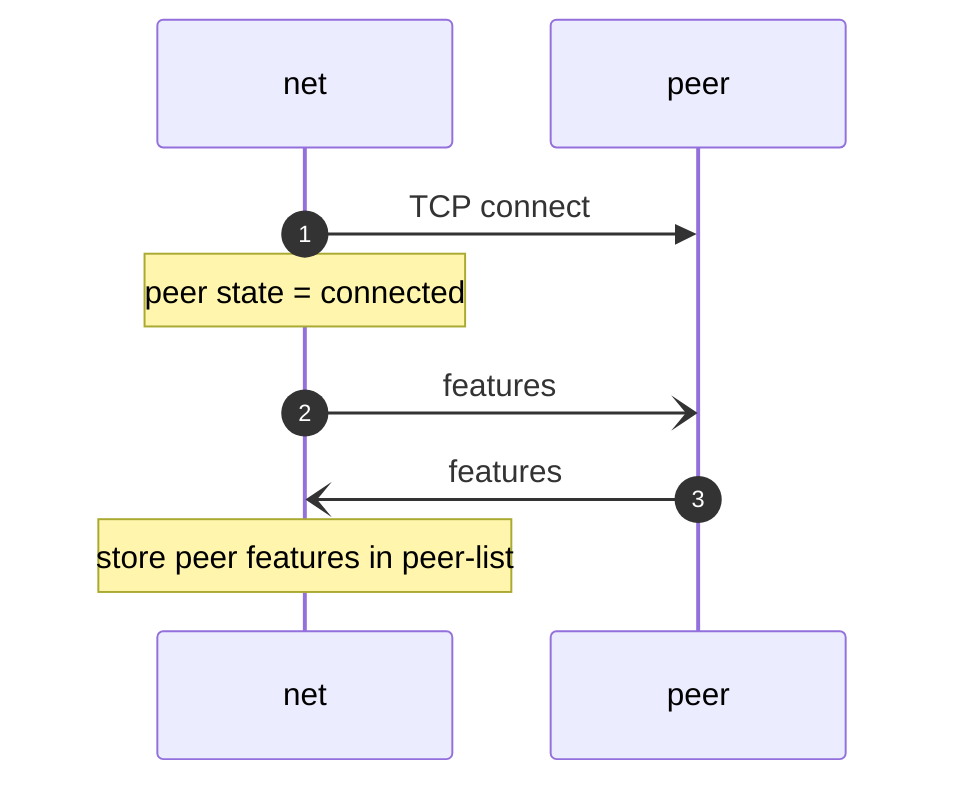
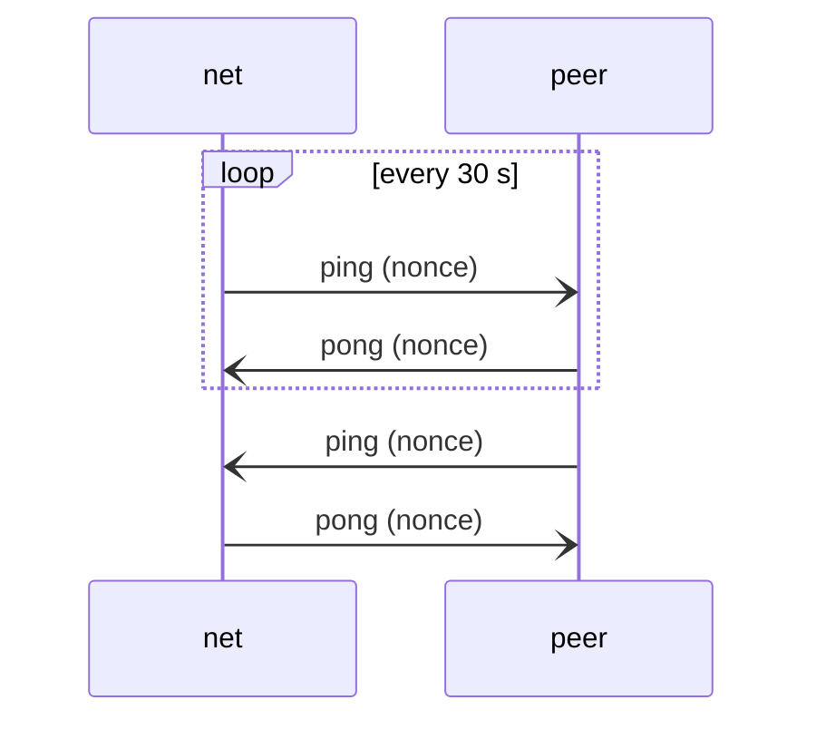
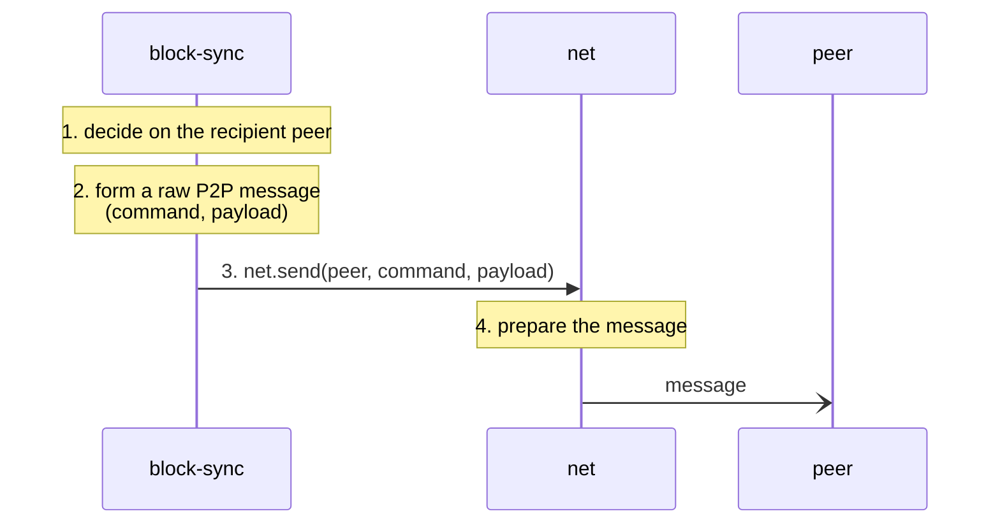
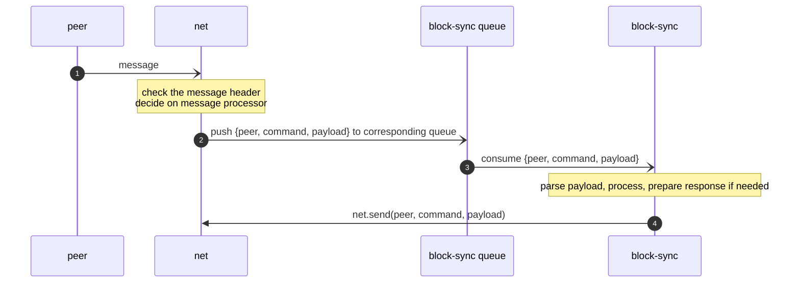
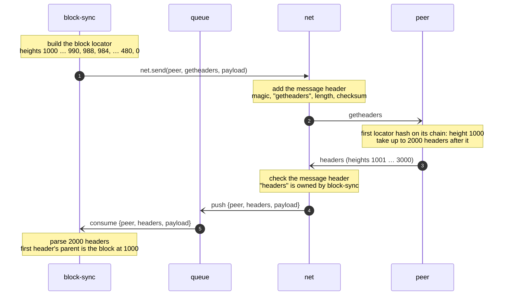

# Communication

This file is mostly refer to ([net](../modules/net/README.md)) module. It gives a high-level overview of how we
establish connections with peers and exchange messages.

## Connecting to the peer

### Features

TBD

---

## Pings

### Missing pong

If the pong is missing we disconnect the peer and initiate reconnect.

---

## Requesting a peer

---

## Processing a request

### Example

`block-sync` asks a peer for the headers that follow its tip at height 1000. The peer's chain extends ours.

> Note: P2P messages carry no request id. `block-sync` recognises the `headers` message as the answer to its
`getheaders` by the peer it comes from and by its content: the first header's parent is a block from the locator.
