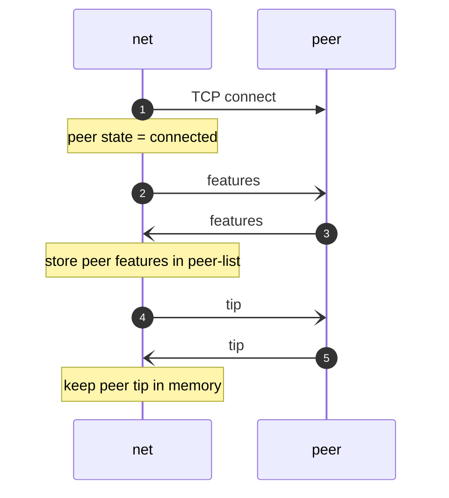
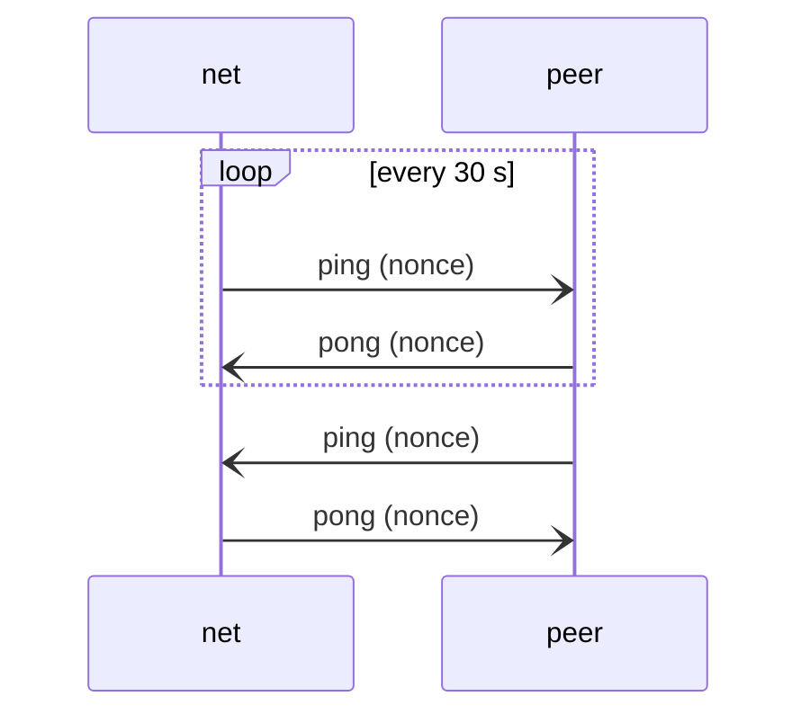
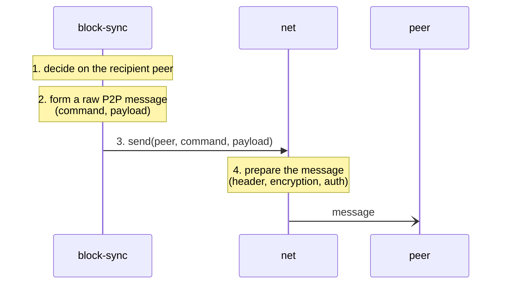
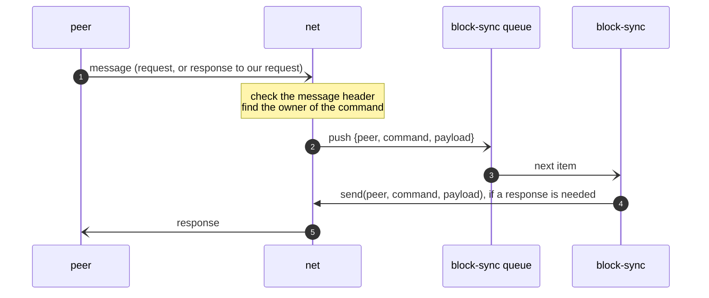

# Connection

Module: [net](../modules/net/README.md).

## Connection flow

```
Connect TCP -> Assume peer connected -> Exchange features -> Exchange tips
```



- Steps 2–3, exchange features: **[Q3](../open-questions.md#q3)**.
- Steps 4–5, exchange tips: **[Q4](../open-questions.md#q4)**.
- Which peers are connected and how many: **[Q5](../open-questions.md#q5)**.

## Pings



A missing `pong`: **[Q7](../open-questions.md#q7)**.

## Requesting a peer



Encryption and authentication: **[Q2](../open-questions.md#q2)**.

## Processing a request



Routing: [net routing table](../modules/net/README.md#routing-table). Messages without an owner: **[Q9](../open-questions.md#q9)**. Invalid messages: **[Q26](../open-questions.md#q26)**.
