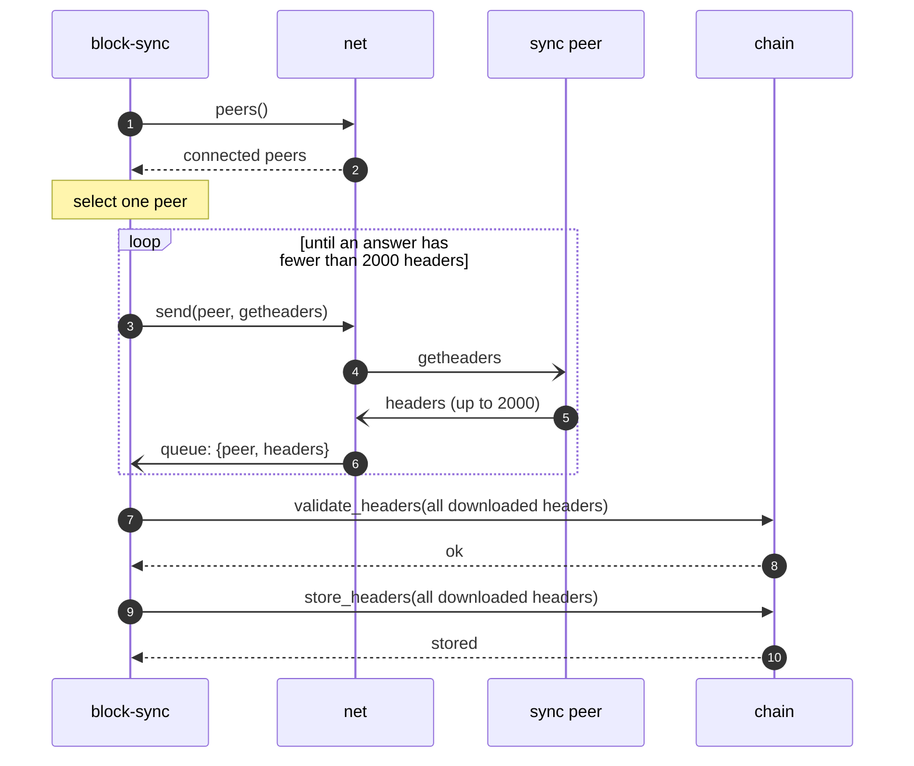
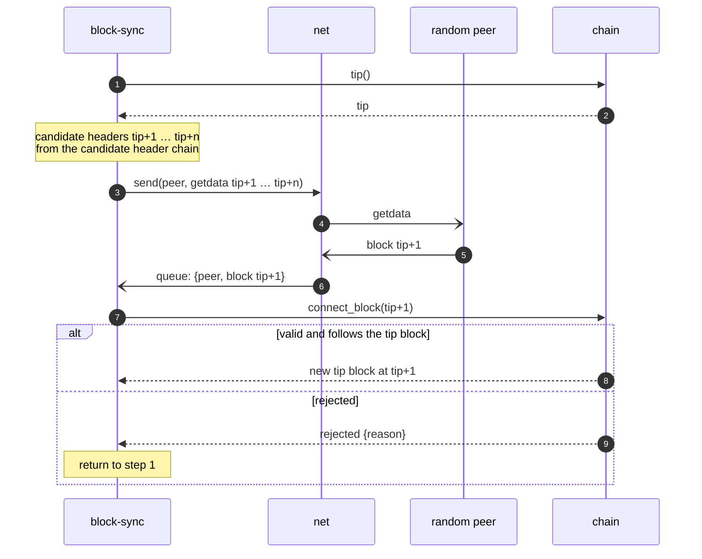

# Initial sync (IBD)

Modules: [block-sync](../modules/block-sync/README.md), [chain](../modules/chain/README.md), [net](../modules/net/README.md).

During IBD all other processes are paused, except maintaining the connections with peers **[Q18](../open-questions.md#q18)**.

When the node is in IBD: **[Q23](../open-questions.md#q23)**.

## Downloading headers

0. `block-sync` selects one peer, using `net` as the CRUD for peers **[Q12](../open-questions.md#q12)**.
1. `block-sync` requests `getheaders` from it, in batches of 2000 headers. The first request carries a locator of the active chain; each next request carries the last header received ([block locator](../modules/block-sync/README.md#block-locator)).
2. `block-sync` continues until it has downloaded all headers this peer knows: an answer with fewer than 2000 headers.
3. `block-sync` validates the whole header chain by calling `chain.validate_headers`, and stores it with `chain.store_headers` **[Q11](../open-questions.md#q11)**.

At this point the node has the ~full header history, validated on the header level only. The downloaded headers form the candidate header chain.

Invalid headers, sync peer disconnect or timeout: **[Q12](../open-questions.md#q12)**, **[Q26](../open-questions.md#q26)**, **[Q27](../open-questions.md#q27)**.

## Downloading blocks

Blocks are downloaded from the beginning.

1. The current tip block is at height `tip`: all headers, and all blocks up to and including the tip block, are validated and stored.
2. `block-sync` knows the candidate header for `tip+1`. It sends `getdata` (`MSG_WITNESS_BLOCK`) for it to a random peer ([peer selection](../modules/block-sync/README.md#peer-selection)). Requests are made in batches **[Q13](../open-questions.md#q13)**.
3. When the data for block `tip+1` is received, `block-sync` requests validation and tip update from `chain` (`connect_block`).
4. If the block is valid and follows the tip block, `chain` updates the tip. Otherwise the block is rejected with the corresponding error.
5. If the block is rejected, return to step 1 **[Q14](../open-questions.md#q14)**.

Blocks of a batch that arrive before block `tip+1` is connected wait in `block-sync` until they are sequential.

End of IBD: **[Q23](../open-questions.md#q23)**.
