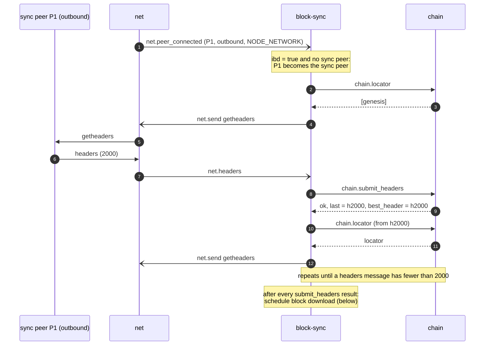
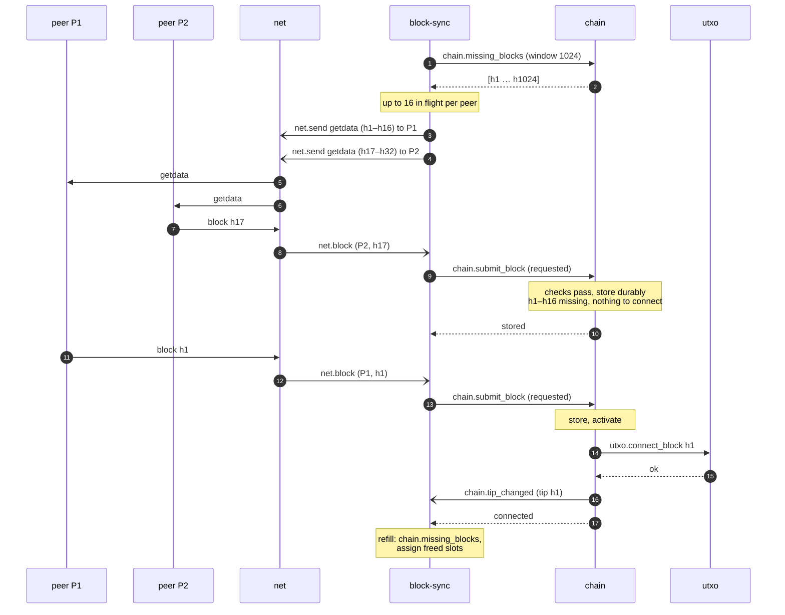
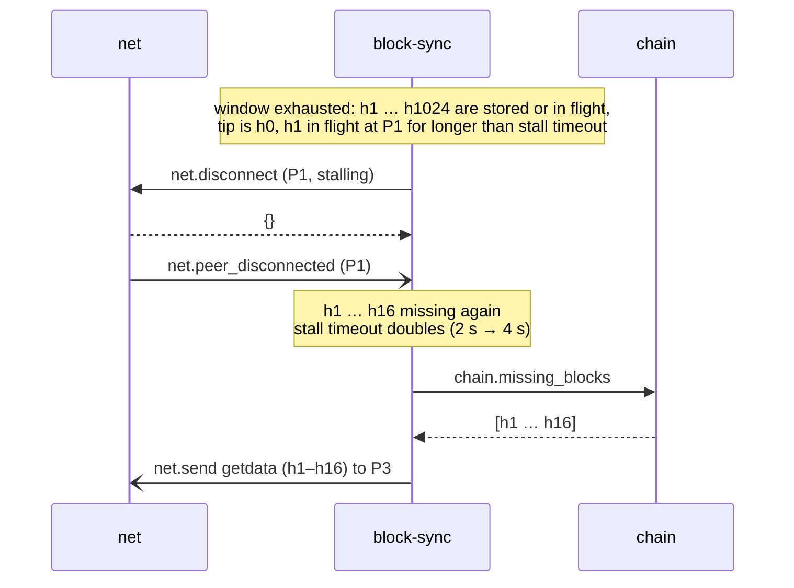

# Initial sync (IBD)

Headers first, then blocks in parallel from many peers, connected in order. Rules:
[block-sync](../daemons/block-sync/README.md), [chain](../daemons/chain/README.md), [utxo](../daemons/utxo/README.md).

## Header sync

- Block download starts as soon as the first batch of headers is accepted; it does not wait for header sync to finish.
- During IBD, headers and block `inv`s from inbound peers are ignored, and only one outbound peer serves headers.
- No progress for `headers_timeout_secs` → `net.disconnect` the sync peer, pick another outbound peer.

## Block download

- Blocks arrive in any order. `chain` stores each one after its own checks and connects only along the chain, so `h17`
  waits until `h2`–`h16` are stored.
- When the gap fills, one `chain.submit_block` call connects a whole run of stored blocks, one `utxo.connect_block` per
  block, and `chain.tip_changed` is split into events of at most 128 blocks.
- During IBD, `block-sync` does not announce blocks.
- Script checks are skipped for blocks below the assumevalid block ([chain](../daemons/chain/README.md#assumevalid));
  every other check runs.

## Stalling

A block requested more than `block_timeout_secs` ago is handled the same way, regardless of the window.

## End of IBD

`chain` computes `ibd = false` once the tip has at least `min_chain_work` and is younger than `max_tip_age_hours`.
The next `chain.tip_changed` carries `ibd: false`:

- `block-sync` starts announcing new blocks, serves `getheaders`, and sends `getheaders` to every peer.
