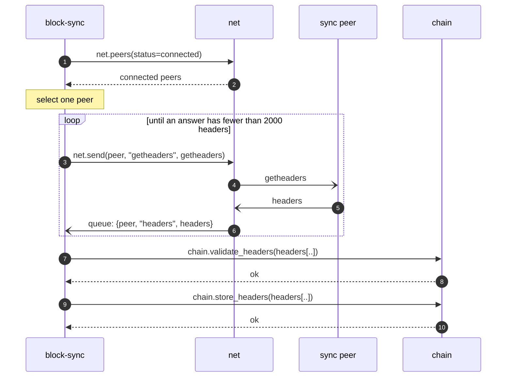
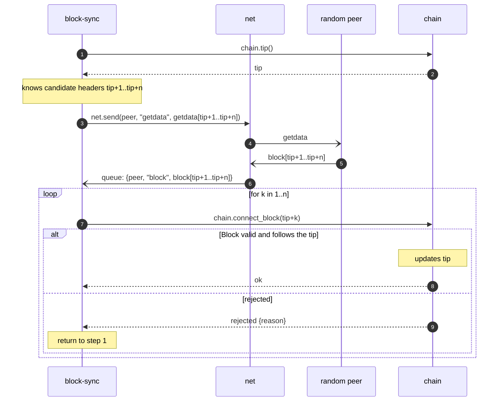

# Bode: Initial Block Download

During IBD all other processes are paused, except maintaining the connections with peers.

The node enters IBD on first launch, when the database is clear and tip is genesis block.

## Downloading headers

1. `block-sync` selects one peer, using `net` as the CRUD for peers.
2. `block-sync` requests `getheaders` from it, in batches of 2000 headers. The first request carries a locator of the
   active chain; each next request carries the last header
   received ([block locator](../modules/block-sync/README.md#block-locator)).
3. `block-sync` continues until it has downloaded all headers this peer knows: an answer with fewer than 2000 headers.
4. `block-sync` validates the whole header chain by calling `chain.validate_headers`, and stores it with
   `chain.store_headers`.

At this point the node has the ~full header history, validated on the header level only. The downloaded headers form the
candidate header chain.

---

## Downloading blocks

Blocks are downloaded from the beginning.

1. The current tip block is at height `tip`: all headers, and all blocks up to and including the tip block, are
   validated and stored.
2. `block-sync` knows the candidate header for `tip+1`. It sends `getdata` (`MSG_WITNESS_BLOCK`) for it to the same
   peer. Requests are made in batches (TBD).
3. When the data for block `tip+1` is received, `block-sync` requests validation and tip update from `chain` (
   `connect_block`).
4. If the block is valid and follows the tip block, `chain` updates the tip. Otherwise, the block is rejected with the
   corresponding error.
5. If the block is rejected, return to step 1.

