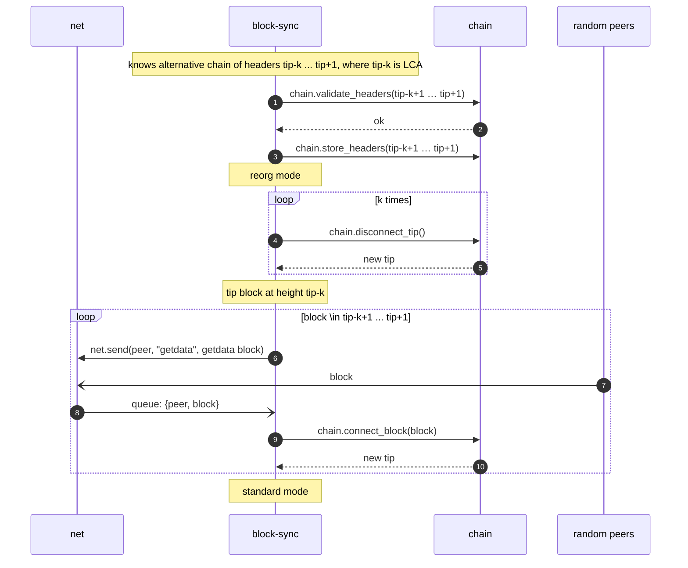

# Mode: Reorg

During a reorg all other processes are paused, except maintaining the connections with peers. Messages in the
`block-sync` queue that are not part of the reorg are skipped. A message is part of the reorg when it answers a request
`block-sync` sent for the reorg.

Reorg happens if in the standard mode, we found a valid chain of headers A..B, where A belongs to the node's current
chain, every header (A+1)..B does not belong to the node's chain and the chain work of B is greater than the chain work
of the tip ([chain work](../modules/chain/README.md#chain-work)). It means that we found a chain with more work than
ours — so we have to reorganize our node. The chain of A..B usually appears when the node receives a header
with unknown parent, so it starts searching LCA as described
in [processing-headers](mode-standard.md#processing-headers).

Note: If the chain work of B is at most the chain work of the tip, it is not a reorg: the headers (A+1)..B are rejected
and not stored. On equal chain work the node keeps its current chain.

A rejected block of the alternative chain is handled as in [IBD](mode-ibd.md#downloading-blocks).

If the node crashes during a reorg, it relaunches in standard mode. The tip is then at some block between the last
common ancestor and the end of the alternative chain, and new blocks are appended over it
in [standard mode](mode-standard.md).
