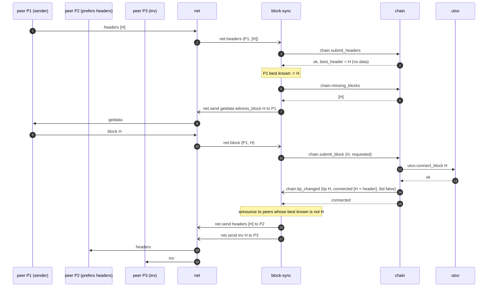
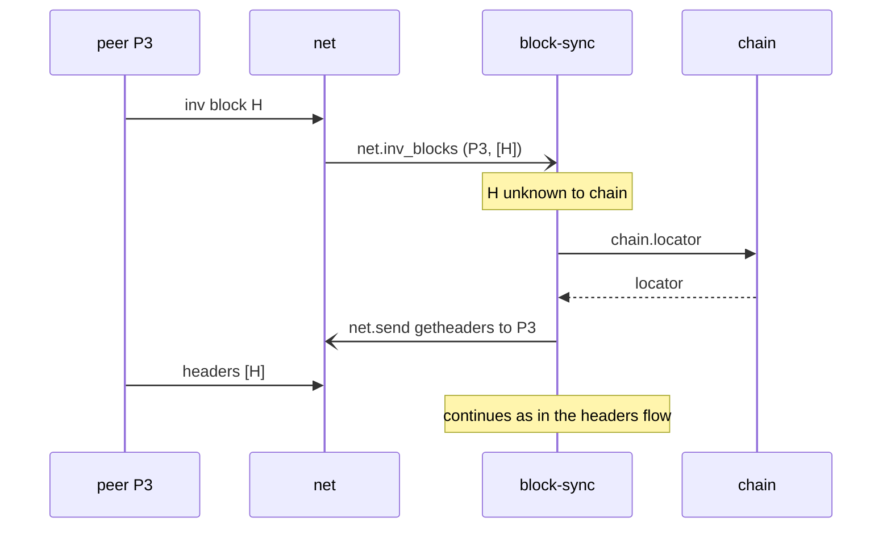
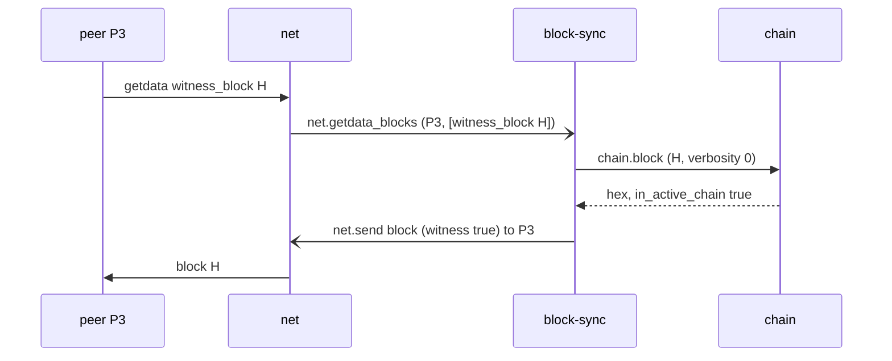

# New block relay

Steady state after IBD: a peer announces a new block; the node fetches it, connects it, and announces it to its other
peers. Rules: [block-sync](../daemons/block-sync/README.md#announcing-new-blocks).

## Announcement by headers (BIP130)

- P1 is skipped in the announcement because its best known block is already H.
- If more than 8 blocks were connected at once (for example after a reorg), peers get an `inv` for the tip instead of
  `headers`.

## Announcement by `inv`

## Serving the block to a peer

Serving a peer's `getheaders` follows the same pattern with `chain.headers_after` and a `headers` message, and is
skipped during IBD.
