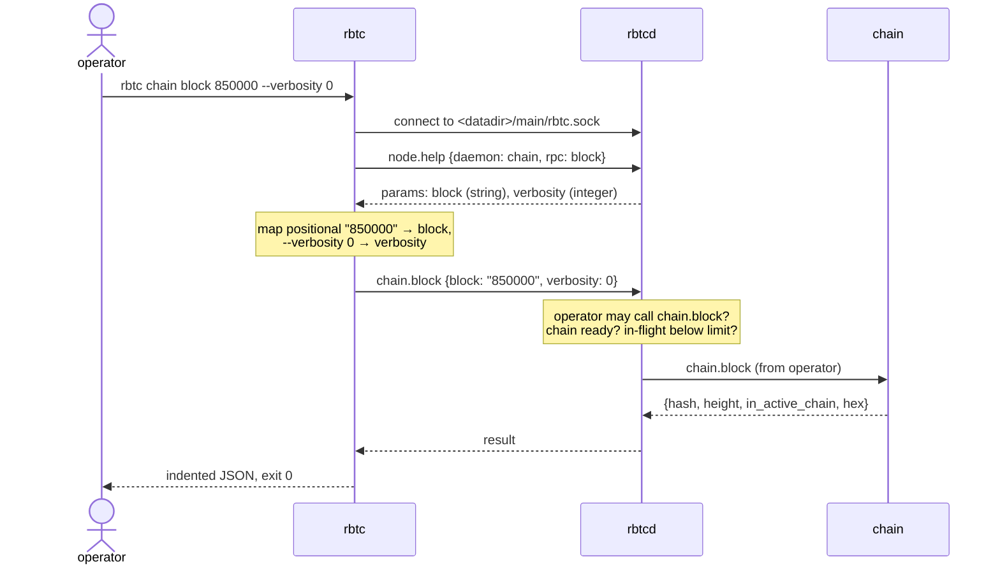

# Operator queries

How the operator reads the node's state with the CLI. Rules: [rpc.md](../architecture/rpc.md#cli), and each daemon's `rpc.md`.

## How one CLI call works



The CLI knows no daemon. Everything it needs comes from `node.help`, so new daemons and new RPCs work without changing it. `node.help` lists only what the caller may call, so internal RPCs such as `utxo.connect_block` look like unknown methods to the operator; a raw request on the socket gets `not_permitted`.

## What the operator can ask in v0.1

| Question | Command | Answered by |
|---|---|---|
| Is the node running, which daemons, which versions? | `rbtc node status` | rbtcd |
| What can I call? | `rbtc help`, `rbtc help chain`, `rbtc help chain block` | rbtcd |
| Where is the chain, is it synced? | `rbtc chain info` | chain |
| How is the sync going? | `rbtc block-sync status` | block-sync |
| A block by height or hash | `rbtc chain block <height or hash> [--verbosity 0]` | chain |
| A header | `rbtc chain header <height or hash>` | chain |
| Forks the node knows about | `rbtc chain tips` | chain |
| A confirmed transaction | `rbtc chain tx <txid> <block>` | chain |
| An unconfirmed transaction | `rbtc tx-relay tx <txid or wtxid>` | tx-relay |
| Unconfirmed transactions known | `rbtc tx-relay list`, `rbtc tx-relay info` | tx-relay |
| Is this output unspent, what does it hold? | `rbtc utxo coin <txid> <vout>` | utxo |
| UTXO set size | `rbtc utxo info` | utxo |
| Broadcast a transaction | `rbtc tx-relay submit <hex>` | tx-relay |
| Peers and traffic | `rbtc net peers`, `rbtc net info` | net |
| Add or drop a peer | `rbtc net connect <host:port>`, `rbtc net disconnect <peer>` | net |
| Stop the node | `rbtc node stop` | rbtcd |
| How is the node wired? | `rbtc node registry` | rbtcd |

## Finding a confirmed transaction without its block

v0.1 has no transaction index, so `chain.tx` needs the block. Two ways to find it:

- If one of its outputs is unspent: `rbtc utxo coin <txid> <vout>` gives the height, then `rbtc chain tx <txid> <height>`.
- Otherwise v0.1 cannot find it.

## Errors the operator sees

```
$ rbtc utxo connect_block 00…
error -32601 method_not_found: utxo has no operator RPC connect_block

$ rbtc chain block 99999999
error 10 not_found: no block at height 99999999 on the active chain
{"reason": "unknown-block"}

$ rbtc chain info        # while chain is still loading its index
error 2 unavailable: chain is not ready
```

Exit codes: 0 success, 1 RPC error, 2 usage error, 3 cannot connect or timed out.
