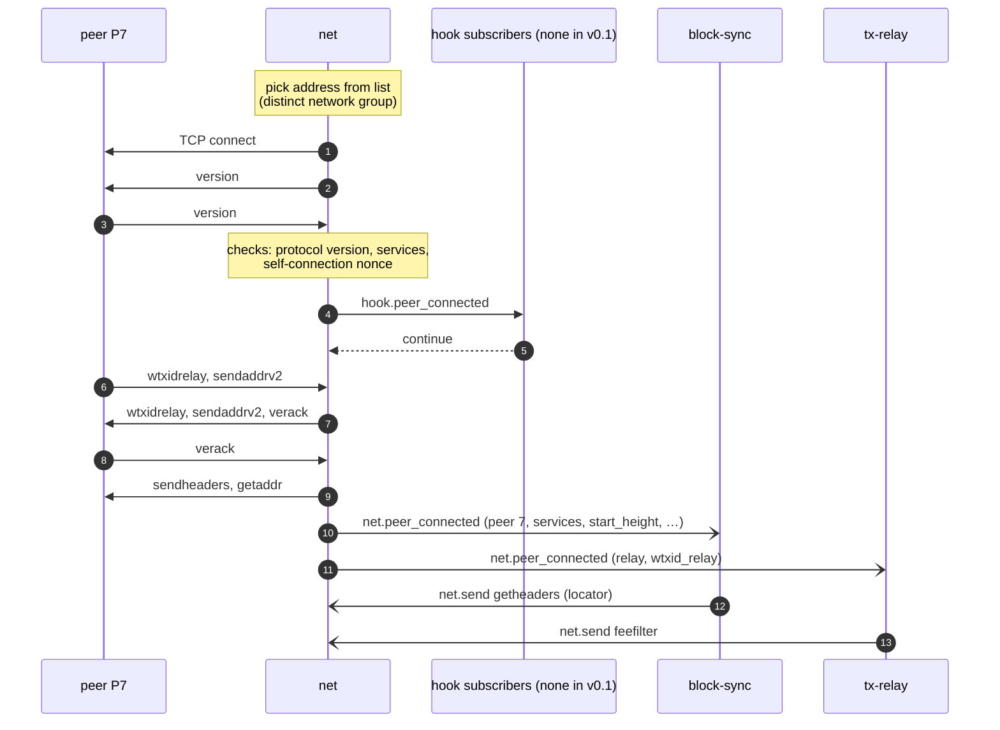
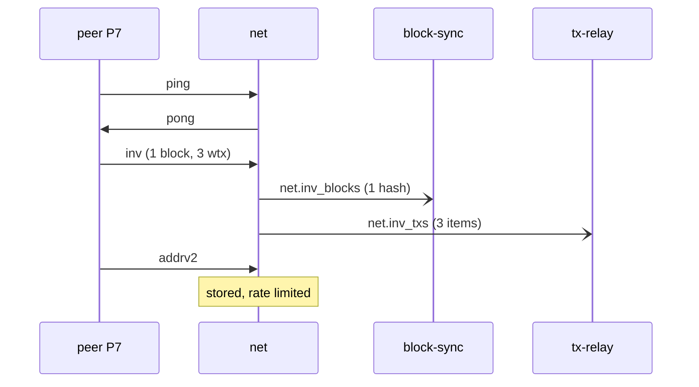
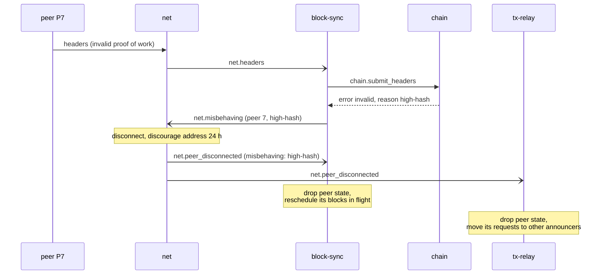

# Peer lifecycle

Rules: [net](../daemons/net/README.md), [hook table](../architecture/events-and-hooks.md#hook-table), [block-sync](../daemons/block-sync/README.md#per-peer-state), [tx-relay](../daemons/tx-relay/README.md#peers).

## Outbound connection and handshake

- Step 4 runs through `rbtcd`, which calls subscribers one by one. With no subscribers, `rbtcd` answers `continue` immediately.
- If the hook rejects, `net` closes the connection without `verack` and emits no event.
- Step 12: `block-sync` sends `getheaders` to a new peer when it is the IBD sync peer or when the node is out of IBD ([block-sync](../daemons/block-sync/README.md#header-synchronisation)).
- Step 13: during IBD the `feefilter` value is the maximum, asking the peer not to announce transactions.

Inbound connections are the same with the first `version` coming from the peer.

## Messages after the handshake

Every message the peer sends is decoded by `net` and either handled inside `net` or emitted as an event for exactly one subscriber ([net message table](../daemons/net/README.md#inbound-message-handling)).

## Misbehaviour

Violations `net` detects itself (undecodable message, size limit, message before handshake, a request for a service that is not offered) follow the same path from "disconnect" on.

## Disconnection for other reasons

Timeouts (`net`'s keep-alive, `block-sync`'s download and stall timeouts through `net.disconnect`), the peer closing the connection, and the operator's `net.disconnect` end the same way: one `net.peer_disconnected` to each subscriber, after every other event about that peer. A `net.send` to a peer that is already gone is dropped silently.
