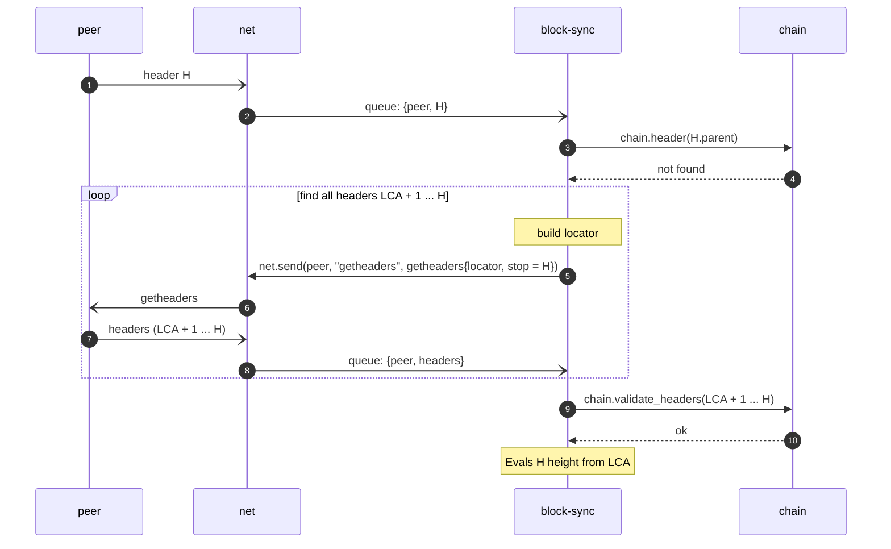

# Processing headers

## Problem statement

A header carries no height. Its height is the parent's height plus one, so it is known only when the parent is stored in
`chain`. For the headers with unknown parent we have to search the last common ancestor to understand the header
height and if the reorg is needed.

## Block locator

Before defining the flow, let's first examine what a block locator is. The `getheaders` is a main request we leverage to
fetch new blocks from chain. But its structure is more tricky than its name assumes:

| Field                | Content                                                                                            |
|----------------------|----------------------------------------------------------------------------------------------------|
| version              | Our protocol version. Core sends it but ignores it on receipt.                                     |
| hash count           | Number of locator hashes. At most 101 (`MAX_LOCATOR_SZ`); Core disconnects a peer that sends more. |
| block locator hashes | Hashes from our chain, newest first (the block locator).                                           |
| hash_stop            | Last header we want. All zeros means "as many as allowed".                                         |

The `getheaders` message asks a peer for the headers of its chain that follow some block. The node does
not know where the peer's chain and ours diverge, so the request can not name one starting block. Instead, the message
carries a **block locator**: a list of block hashes from our active chain, newest first. The peer matches the list
against its own chain to find a block both chains have, and answers from there.

The other peer (assuming it is Bitcoin Core) handles this request as follows:

1. It goes through the locator in order and takes the first hash that is on its own active chain. That block is on both
   chains.
2. It answers with the headers of its active chain that follow that block: at most 2000, ending with the stop hash if it
   reaches it. A zero stop hash means no limit other than 2000.
3. If no locator hash is on its active chain, it answers from the block after genesis.

The parent of the first header in the answer is the block found in step 1, so node then knows that block's height and
can count the heights of all headers in the answer.

A **full locator** finds a common block in one round trip, however far back the chains diverge. As in Core's
`GetLocator`, it is dense near the tip and sparse further back: the tip, the 10 blocks before it, then steps that double
at every entry, always ending with genesis. For a tip at height 1000 the heights are:

```
1000, 999, ..., 990, 988, 984, 976, 960, 928, 864, 736, 480, 0
```

About 20 hashes cover any chain length; the protocol allows at most 101. Because the locator is sparse further back, the
block found by the peer can be below the actual fork point. The headers between them are already on our active chain and
are skipped (step 3 below).

## Flow

So, imagine we received a header from random peer. After validation (if successful) we have to find its
theoretical height. We first try searching its parent in `headers` table. If the entry exists, we will obtain all
information we may need (i.e. height and status). Otherwise, we start trying searching the last common ancestor (LCA).



If the LCA is the current tip we continue in the standard flow. Otherwise, we fall into reorg mode.