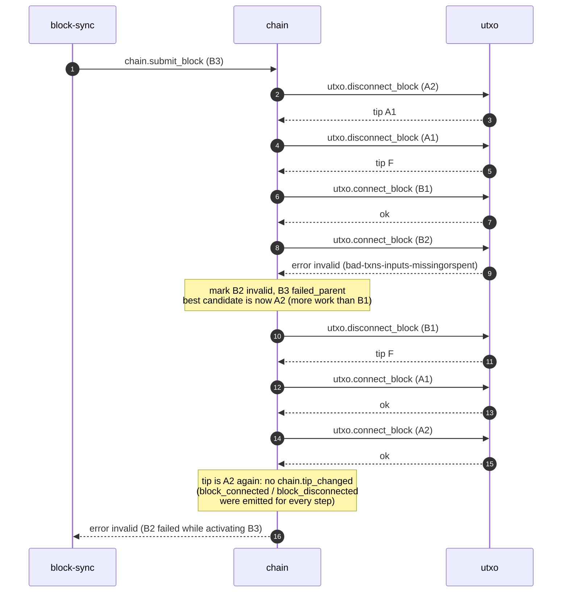

# Reorg

`chain` switches the active chain to a branch with more work. Rules: [best-chain activation](../daemons/chain/README.md#best-chain-activation), [utxo disconnect](../daemons/utxo/rpc.md#utxodisconnect_block), [storage crash cases](../architecture/storage.md#crash-cases).

Starting point: active chain `… F – A1 – A2` (tip A2). A competing branch `F – B1 – B2 – B3` arrives; B1 and B2 were stored earlier as a side branch with less work.

## Successful reorg

```mermaid
sequenceDiagram
    autonumber
    participant BS as block-sync
    participant C as chain
    participant U as utxo
    participant N as net
    participant TR as tx-relay

    BS->>C: chain.submit_block (B3)
    Note over C: checks pass, store B3<br/>branch B has more work than A
    Note over C: fork point F
    C->>U: utxo.disconnect_block (A2)
    U-->>C: tip A1
    C->>U: utxo.disconnect_block (A1)
    U-->>C: tip F
    C->>U: utxo.connect_block (B1)
    U-->>C: ok
    C->>U: utxo.connect_block (B2)
    U-->>C: ok
    C->>U: utxo.connect_block (B3)
    U-->>C: ok
    Note over C: emitted along the way:<br/>block_disconnected A2, A1<br/>block_connected B1, B2, B3
    C-)N: chain.tip_changed (tip B3, connected [B1,B2,B3], disconnected [A2,A1])
    C-)BS: chain.tip_changed
    C-)TR: chain.tip_changed
    C-->>BS: connected
    Note over BS: announce B3 (headers B1–B3 or inv)
    Note over TR: check cache inputs with utxo.unspent;<br/>A1/A2 transactions are not re-added
```

- Each `utxo.disconnect_block` and `utxo.connect_block` is atomic on its own. Between steps, the UTXO set is at a consistent intermediate tip. A crash anywhere in the middle restarts from that tip, and activation finishes the reorg ([storage.md](../architecture/storage.md#crash-cases)).
- Read RPCs during a reorg can observe the intermediate tips.

## Reorg to a branch that turns out invalid



- `chain.submit_block` for B3 returns `invalid` because B3's own ancestor failed and B3 is now marked `failed_parent`. `block-sync` punishes the peer that sent B3.
- A1 and A2 were connected before and are known valid, so reconnecting them cannot fail unless the database is corrupt.
- The tip ends where it started, so no `chain.tip_changed` is emitted. Subscribers of the per-block events see every step, including the undone B1. A transaction that tx-relay validated with `utxo.check_tx` while the UTXO set was at an intermediate tip may no longer fit; the cache check at the next tip change removes it.
