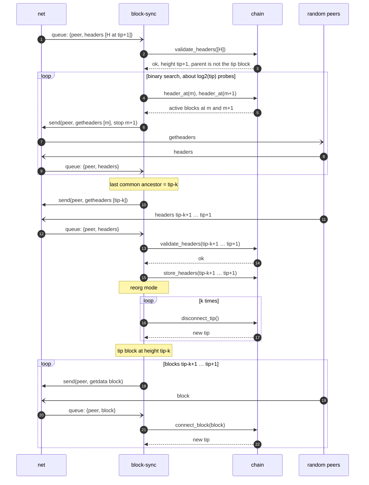

# Reorgs

Modules: [block-sync](../modules/block-sync/README.md), [chain](../modules/chain/README.md), [net](../modules/net/README.md).

During a reorg all other processes are paused, except maintaining the connections with peers **[Q18](../open-questions.md#q18)**.

In every case below `tip` is the height of the current tip block: all headers, and all blocks up to and including the tip block, are validated and stored. Heights are written relative to it: `tip+1`, `tip-k`, `tip+t`.

## Height of a received header

A header carries no height. When `block-sync` receives a header:

- if its parent is stored in `chain`, its height is the parent's height plus one (`chain.validate_headers` returns it), and the cases below apply directly;
- if its parent is not stored, `block-sync` first downloads the headers between the active chain and it (`getheaders` with a locator of the active chain to the peer that sent it, validated and stored through `chain`). Its height is then known and the matching case below applies.

## Next header

0. The current tip block is at height `tip`.
1. `block-sync` receives a new header for height `tip+1`.
2. After validation via `chain`, it has a valid chain work but does not connect to the tip block **[Q20](../open-questions.md#q20)**.
3. `block-sync` searches for the last common ancestor (binary search) with `getheaders` probes on random peers ([last common ancestor search](../modules/block-sync/README.md#last-common-ancestor-search)) **[Q19](../open-questions.md#q19)**. Assume the last common ancestor is `tip-k`.
4. `block-sync` downloads and verifies the k+1 headers from `tip-k+1` to `tip+1` (`getheaders` whose locator is the block at `tip-k`, then `chain.validate_headers` and `chain.store_headers`).
5. The node is now in reorg mode.
6. `block-sync` downgrades the tip sequentially to `tip-k` with `chain.disconnect_tip`, which updates the UTXO set and the other tables.
7. `block-sync` downloads the blocks `tip-k+1` … `tip+1` sequentially (`getdata`, `MSG_WITNESS_BLOCK`), and validates them and updates the tip via `chain.connect_block`.

Rejection of a block of the new branch during step 7, and a crash during steps 6–7: **[Q21](../open-questions.md#q21)**.

## Next header (+t)

0. The current tip block is at height `tip`.
1. `block-sync` receives a new header for height `tip+t`.
2. `block-sync` downloads the headers `tip+1` … `tip+t` (`getheaders` with a locator of the active chain to the peer that sent the header). If the header at `tip+1` follows the tip block, it is NOT a reorg: the headers are processed as in [standard mode](standard-mode.md#new-header).
3. Otherwise `block-sync` follows [Next header](#next-header) for the header at `tip+1`.

## Current header or older

0. The current tip block is at height `tip`.
1. `block-sync` receives a new header for height `tip` or `tip-k`.
2. The header is rejected. It is NOT a reorg **[Q22](../open-questions.md#q22)**.
