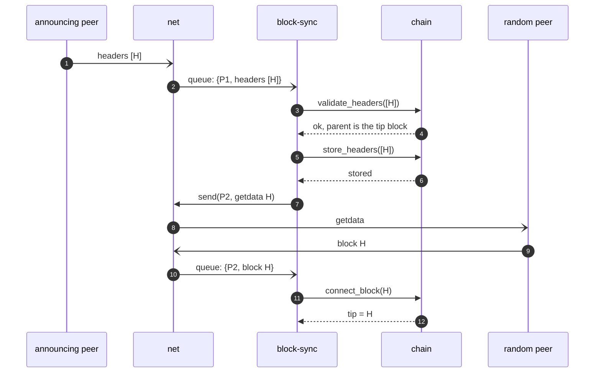

# Standard mode

Modules: [block-sync](../modules/block-sync/README.md), [chain](../modules/chain/README.md), [net](../modules/net/README.md).

In standard mode the node receives headers and transactions from random connected peers. This flow assumes there are no reorgs; reorgs are in [reorg.md](reorg.md).

## New header

1. When a header is received, `block-sync` calls validation and storing on `chain` (`validate_headers`, `store_headers`).
2. If the header is valid, meaning it is the next header (its parent is the tip), `block-sync` requests the block with `getdata` (`MSG_WITNESS_BLOCK`) from a random peer **[Q17](../open-questions.md#q17)**.
3. When the block is received, `block-sync` calls validation and tip update on `chain` (`connect_block`).

How peers announce new blocks (`headers` or `inv`): **[Q16](../open-questions.md#q16)**.

A received header that does not follow the tip: [reorg.md](reorg.md).

## New transaction

Transactions are not accepted, because no mempool is maintained. Transaction messages have no owner in the [routing table](../modules/net/README.md#routing-table) **[Q9](../open-questions.md#q9)**.
