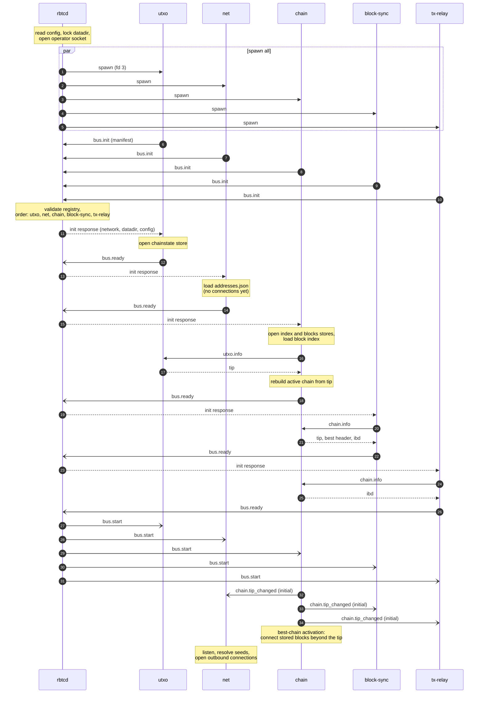
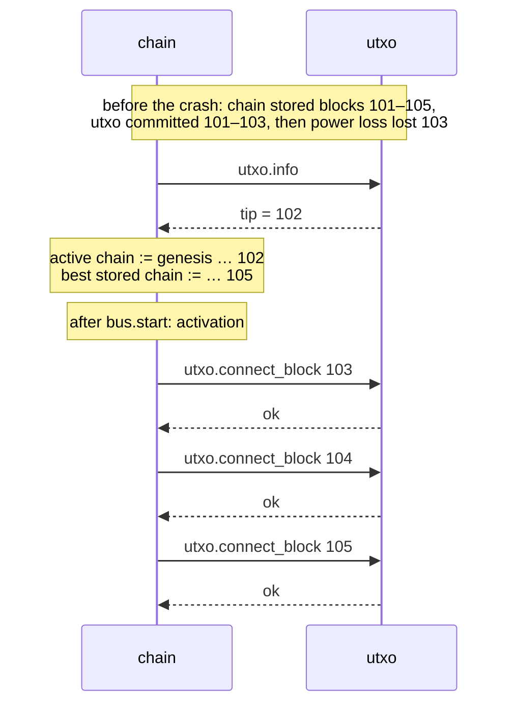
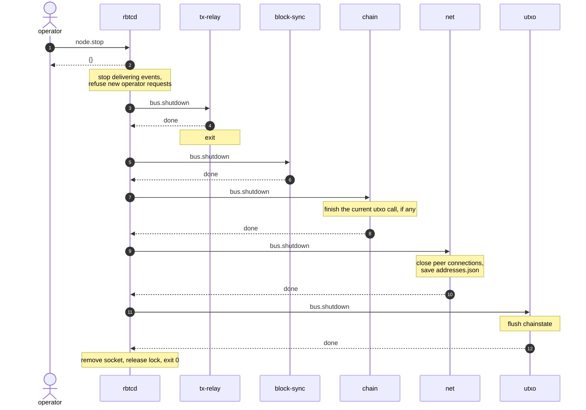
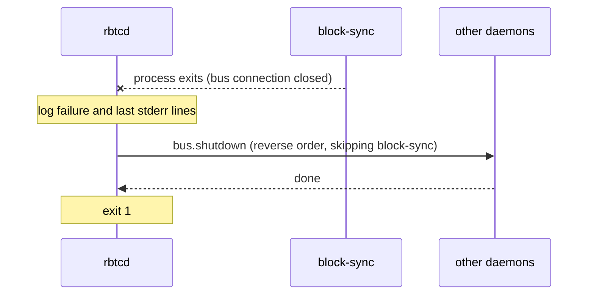

# Startup and shutdown

Rules: [lifecycle.md](../architecture/lifecycle.md), [manifest.md](../architecture/manifest.md), [storage.md](../architecture/storage.md#startup-reconciliation).

## Startup

Notes:

- Steps 2–6: `rbtcd` answers no `bus.init` until all manifests are in and the registry is valid. A daemon that sends an invalid manifest makes the whole startup fail with the full list of problems.
- Each daemon initialises only after its dependencies are ready, so `chain` can call `utxo.info`, and `block-sync` and `tx-relay` can call `chain.info`, during initialisation.
- No event exists before `bus.start`. The initial `chain.tip_changed` gives every subscriber the starting tip.

## Recovery after a crash

Nothing special runs. The normal startup above is the recovery:

## Shutdown

## A daemon fails

