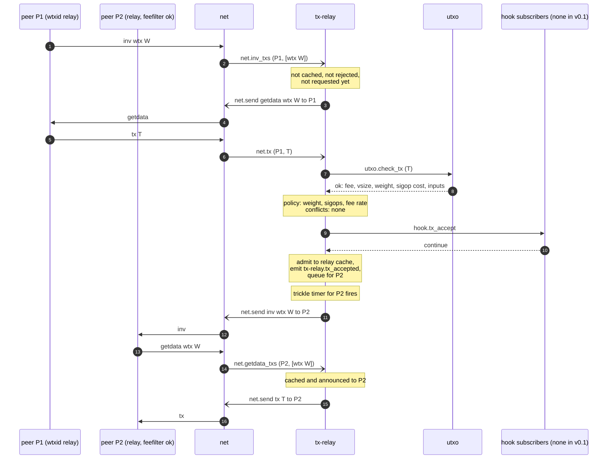
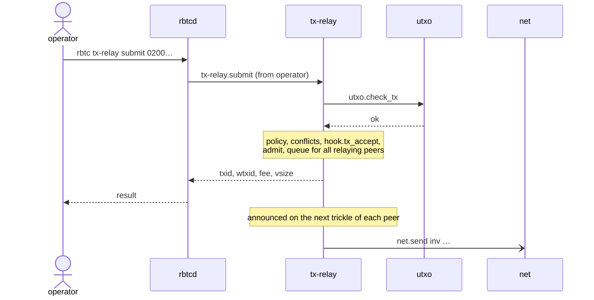
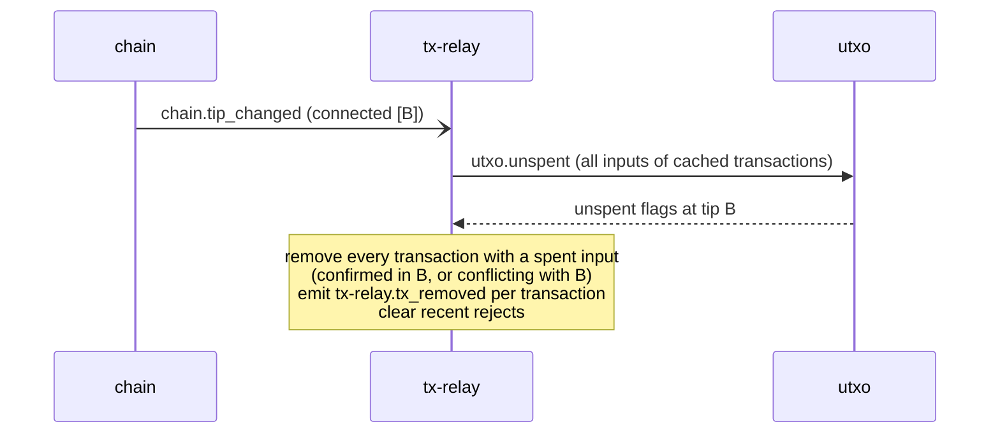

# Transaction relay

Rules: [tx-relay](../daemons/tx-relay/README.md), [utxo.check_tx](../daemons/utxo/rpc.md#utxocheck_tx), [hook table](../architecture/events-and-hooks.md#hook-table).

## A peer announces a transaction

Rejections:

| `utxo.check_tx` or check result | tx-relay does |
|---|---|
| `missing_inputs` | remembers T as rejected until the next tip change; nothing else |
| `invalid` | remembers T as rejected; `net.misbehaving` for P1 |
| policy failure, conflict, hook reject, cache full | remembers T as rejected |

A peer without wtxid relay announces and requests by txid (`tx`, `witness_tx`) instead of wtxid; the flow is the same.

## The operator submits a transaction

Errors go back to the operator (`invalid`, `missing_inputs`, `rejected`); no peer is punished. During IBD the submission is refused with `rejected` / `initial-block-download`.

## A block confirms or conflicts with cached transactions

If the cache is empty, no call is made.

## Expiry and eviction

- Every minute, entries older than `expiry_hours` are removed (`tx-relay.tx_removed`, reason `expired`).
- When a new transaction does not fit in `max_cache_mib`, entries with a lower fee rate are evicted first (`evicted`). If that is not enough, the new transaction is rejected.
